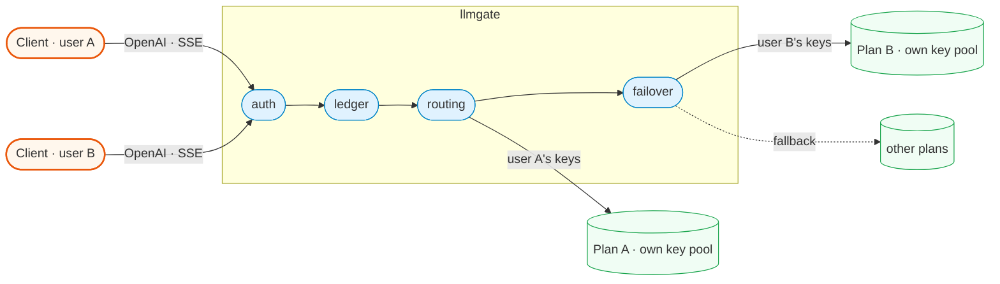

# llmgate

A multi-user, OpenAI-compatible gateway that routes each user's traffic through the upstream API keys they contributed. Go + SQLite, single container, embedded admin UI.



## Features

- Multi-user: the admin creates accounts; users sign in with username and password and manage only their own data.
- Bring your own key (BYOK): users record their own upstream API keys into admin-defined channels. Every key is tagged with its owner, is visible only to that owner, and is used only for that owner's requests. A key may be a plain value (`sk-...`) or an `AK:SK` pair; owners (and admins) can copy the full key, the AK, or the SK separately from the key list.
- Per-user gateway tokens: users issue and revoke multiple `sk-` tokens for their own consumption; each token resolves to its owner.
- Channel key pools with priority / weight based routing; downstream switch on rate limit, quota exhaustion, or upstream error.
- Circuit breaker keyed to a consecutive-failure threshold (default 6 failures in 30s) with exponential backoff, cleared automatically after a successful probe.
- Per-user call ledger; API keys and gateway tokens stored AES-256-GCM encrypted; disabling a channel deactivates all of its keys and routes.
- Billing records calls, upload tokens, and download tokens per user and per model; admin UI covering channels, routes, users, logs, and settings.

## Deploy

```bash
cp config.example.yaml config.yaml   # optional: set admin_token / encrypt_seed
docker compose up -d --build         # open http://localhost:3210
```

Setup: sign in with the admin token, create a channel and (optionally) test it, then create user accounts under **Users**. A user then signs in with their username and password, adds their own API keys under **My API Keys**, and issues a gateway token under **My Tokens**.

```bash
curl http://localhost:3210/v1/chat/completions \
  -H "Authorization: Bearer sk-your-token" -H "Content-Type: application/json" \
  -d '{"model":"deepseek/deepseek-v4-flash","messages":[{"role":"user","content":"hello"}]}'
```

### Audio endpoints

The gateway also proxies OpenAI-compatible audio APIs:

```bash
# File transcription (multipart/form-data)
curl http://localhost:3210/v1/audio/transcriptions \
  -H "Authorization: Bearer sk-your-token" \
  -F model="qwen/qwen3-asr-flash" \
  -F file=@sample.wav

# Text-to-speech (JSON -> audio bytes)
curl http://localhost:3210/v1/audio/speech \
  -H "Authorization: Bearer sk-your-token" -H "Content-Type: application/json" \
  -d '{"model":"google/gemini-3.8-flash-tts","input":"hello","voice":"alloy"}' \
  -o out.mp3

# Realtime (WebSocket); pass model as a query parameter
# ws://localhost:3210/v1/realtime?model=openai/gpt-realtime

# Deepgram-compatible streaming ASR (WebSocket)
# ws://localhost:3210/v1/listen?model=nova-3&language=en
# add &aggregate=1 to receive gateway_transcript/gateway_final on every message

# Deepgram-compatible pre-recorded transcription (raw audio body)
curl "http://localhost:3210/v1/listen?model=nova-3&language=en" \
  -H "Authorization: Token sk-your-token" -H "Content-Type: audio/wav" \
  --data-binary @sample.wav

# Realtime session creation (issued locally, no upstream call)
curl http://localhost:3210/v1/realtime/transcription_sessions \
  -H "Authorization: Bearer sk-your-token" -H "Content-Type: application/json" \
  -d '{"model":"gpt-4o-transcribe","input_audio_format":"pcm16"}'
```

Gateway tokens are accepted with either `Authorization: Bearer sk-...` or
`Authorization: Token sk-...` (the latter matches Deepgram-style clients).

Transcription first forwards to the upstream `/v1/audio/transcriptions`; if the upstream
does not expose that endpoint, it falls back to `/v1/chat/completions` with `input_audio`
(works with chat-audio ASR models such as `qwen3-asr-flash`). That chat fallback is
one-shot and cannot emit partials; use `/v1/realtime` (OpenAI-compatible) or `/v1/listen`
(Deepgram-compatible) for streaming partial results.

Deepgram channels use `Adapter: deepgram` in the channel dialog and authenticate upstream
with `Authorization: Token <key>`. Deepgram has no `/v1/models`, so channel sync uses a
built-in catalog (`nova-3`, `nova-2`, `enhanced`, ...) instead of calling upstream.

Realtime session endpoints (`/v1/realtime/sessions` and
`/v1/realtime/transcription_sessions`) are issued by the gateway itself: they return an
`id`, `expires_at` (10 minutes) and `client_secret.value` (`ek_...`). Browsers can then
connect to `/v1/realtime?api_key=ek_...` or `/v1/listen?api_key=ek_...` without custom
headers. Session tokens are model-bound and are rejected on non-WebSocket requests.

`/v1/listen?aggregate=1` keeps Deepgram's native partial/final messages untouched and adds
`gateway_transcript` (accumulated text with word-level overlap dedup) plus `gateway_final`.
Without `aggregate=1` the gateway is a pure pass-through.

For TTS upstreams that return PCM inside JSON (qwen/grok style), the gateway unwraps and
wraps PCM as WAV; pass `"response_format":"pcm"` to receive raw PCM instead.

Billing only records call counts and upload/download token volumes per user and model:

- transcription: upstream `usage` tokens when returned, otherwise WAV duration × 1000 tokens/s;
- Deepgram pre-recorded: upstream `metadata.duration`, otherwise WAV header duration × 1000 tokens/s;
- speech: upstream usage tokens when returned, otherwise input characters ÷ 4;
- realtime / Deepgram streaming: connection seconds × 1000 tokens/s.

Upstream support is required for each endpoint; if a provider only offers chat-based audio
(e.g. `qwen3-asr-flash` via `input_audio`), use `/v1/chat/completions` instead.

## Configuration

Runtime settings live in `config.yaml` (see [`config.example.yaml`](config.example.yaml)); it is mounted into the container read-only, and changes take effect after `docker compose restart`. Every key is optional and falls back to a built-in default: `admin_token`, `encrypt_seed`, `http_addr`, `db_path`, `gateway_prefix`, `log_level`, `tz`, `session_ttl_hours`, `proxy`, `trusted_proxies`. A typo in a key name is a startup error.

The legacy `LGM_*` environment variables are still read for backward compatibility, but the config file takes precedence. Circuit-breaker parameters can be tuned in the admin Settings.

## Docs

- Deployment & operations: [deploy.md](docs/deploy.md)
- Design: [design.md](docs/design.md)

## License

[MIT](LICENSE) © 2026 Ma Tianyi