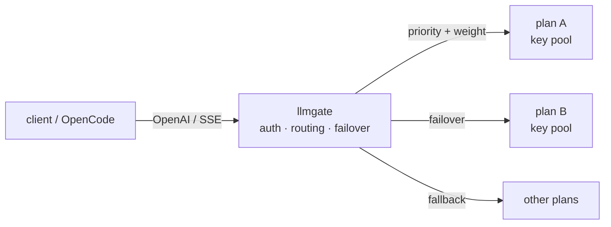

# llmgate

聚合多个上游大模型套餐 Key 的 OpenAI 兼容网关。Go + SQLite，单容器部署，管理前端内嵌于二进制。



## 设计要点

- 一个对外模型名映射多条「渠道 × 上游模型」，按优先级与权重分发；高优先级吃满，其余兜底。
- 上游限流 / 欠费 / 5xx / 超时自动下沉下一候选。冷却采用连续失败阈值（默认 30s 窗口内 6 次），指数退避 2s→4s→8s，探活成功后即恢复。流式在首个事件前失败透明换路。
- 上游模型可自动加厂商前缀（`deepseek-v4-flash` → `deepseek/deepseek-v4-flash`），转发改写为真实名；亦支持自定义路由。
- 透传 `x-opencode-session` 等会话头，缺失时自动生成稳定会话 ID，可直接作为 OpenCode 的 API provider。
- 每用户独立 `sk-xxx` + 配额上限；API Key AES-256-GCM 加密落库；停用渠道即失效其全部 Key 与路由。

## 功能

- 渠道：多 Key 池（独立启停 / 权重 / 换密钥）、优先级、权重、额外请求头、连通测试。
- 路由：定时同步 `/v1/models`、清理下架模型；多映射按优先级 + 权重分发。
- 网关：`/v1/chat/completions`（SSE）、`/v1/completions`、`/v1/embeddings`、`/v1/models`。
- 用量：异步批量落库；仪表盘提供今日用量、趋势、失败明细及用户 × 模型维度统计，按内置 190+ 模型单价估算费用。
- 后台：Dashboard / Channels / Model Routes / Users / Logs / Settings。
- 熔断阈值、冷却窗口、配额冷却时长、探活退避可于后台 Settings（`Failover` 分类）调整，无需重编译。

## 使用

```bash
cp .env.example .env
docker compose up -d --build

# -> http://localhost:3210
```

流程：Channels 建渠道 → Test 连通 → Sync All Routes 拉模型 → Users 建用户取令牌。

```bash
curl http://localhost:3210/v1/chat/completions \
  -H "Authorization: Bearer sk-令牌" -H "Content-Type: application/json" \
  -d '{"model":"deepseek/deepseek-v4-flash","messages":[{"role":"user","content":"hi"}]}'
```

## 配置

 | 变量                       | 默认                        | 说明                         |
 | ---                        | ---                         | ---                          |
 | `LGM_ADMIN_TOKEN`          | 必填                        | 管理端令牌                   |
 | `LGM_HTTP_ADDR`            | `:3210`                     | 监听地址                     |
 | `LGM_PROXY`                | 直连                        | 上游出站代理（`socks5://…`） |
 | `LGM_ENCRYPT_SEED`         | 首次生成                    | Key 加密种子                 |
 | `LGM_DB_PATH`              | `./data/llmgate.db`         | SQLite 路径                  |
 | `LGM_GATEWAY_PREFIX`       | `/`                         | 网关前缀                     |
 | `LGM_LOG_LEVEL` / `LGM_TZ` | `release` / `Asia/Shanghai` | 日志 / 时区                  |

## 文档

- 部署与运维：[deploy.md](docs/deploy.md)
- 设计决策：[design.md](docs/design.md)

## License

[MIT](LICENSE) © 2026 马天弋
