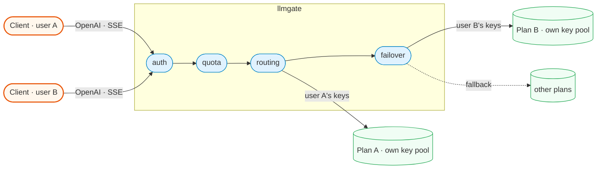

# llmgate

A multi-user, OpenAI-compatible gateway that routes each user's traffic through the upstream API keys they contributed. Go + SQLite, single container, embedded admin UI.



## Features

- Multi-user: the admin creates accounts; users sign in with username and password and manage only their own data.
- Bring your own key (BYOK): users record their own upstream API keys into admin-defined channels. Every key is tagged with its owner, is visible only to that owner, and is used only for that owner's requests.
- Per-user gateway tokens: users issue and revoke multiple `sk-` tokens for their own consumption; each token resolves to its owner.
- Channel key pools with priority / weight based routing; downstream switch on rate limit, quota exhaustion, or upstream error.
- Circuit breaker keyed to a consecutive-failure threshold (default 6 failures in 30s) with exponential backoff, cleared automatically after a successful probe.
- Per-user quotas; API keys and gateway tokens stored AES-256-GCM encrypted; disabling a channel deactivates all of its keys and routes.
- Per-user, per-model usage statistics and a dashboard; admin UI covering channels, routes, users, logs, and settings.

## Deploy

```bash
cp .env.example .env           # set LGM_ADMIN_TOKEN
docker compose up -d --build   # open http://localhost:3210
```

Setup: sign in with the admin token, create a channel and (optionally) test it, then create user accounts under **Users**. A user then signs in with their username and password, adds their own API keys under **My API Keys**, and issues a gateway token under **My Tokens**.

```bash
curl http://localhost:3210/v1/chat/completions \
  -H "Authorization: Bearer sk-your-token" -H "Content-Type: application/json" \
  -d '{"model":"deepseek/deepseek-v4-flash","messages":[{"role":"user","content":"hello"}]}'
```

### Audio endpoints

The gateway also proxies OpenAI-compatible audio APIs:

```bash
# File transcription (multipart/form-data)
curl http://localhost:3210/v1/audio/transcriptions \
  -H "Authorization: Bearer sk-your-token" \
  -F model="qwen/qwen3-asr-flash" \
  -F file=@sample.wav

# Text-to-speech (JSON -> audio bytes)
curl http://localhost:3210/v1/audio/speech \
  -H "Authorization: Bearer sk-your-token" -H "Content-Type: application/json" \
  -d '{"model":"google/gemini-3.8-flash-tts","input":"hello","voice":"alloy"}' \
  -o out.mp3

# Realtime (WebSocket); pass model as a query parameter
# ws://localhost:3210/v1/realtime?model=openai/gpt-realtime
```

Transcription first forwards to the upstream `/v1/audio/transcriptions`; if the upstream
does not expose that endpoint, it falls back to `/v1/chat/completions` with `input_audio`
(works with chat-audio ASR models such as `qwen3-asr-flash`). Realtime supports
OpenAI-compatible WebSocket upstreams; Deepgram-specific protocols are not supported.
For TTS upstreams that return PCM inside JSON (qwen/grok style), the gateway unwraps and
wraps PCM as WAV; pass `"response_format":"pcm"` to receive raw PCM instead.

Billing uses the same model price table:

- transcription: upstream `usage` tokens when returned, otherwise WAV duration × 1000 tokens/s;
- speech: upstream usage tokens when returned, otherwise input characters ÷ 4;
- realtime: connection seconds × 1000 tokens/s.

Upstream support is required for each endpoint; if a provider only offers chat-based audio
(e.g. `qwen3-asr-flash` via `input_audio`), use `/v1/chat/completions` instead.

## Configuration

Main environment variables are documented in [`.env.example`](.env.example) (`LGM_ADMIN_TOKEN`, `LGM_HTTP_ADDR`, `LGM_PROXY`, ...). Circuit-breaker parameters can be tuned in the admin Settings.

## Docs

- Deployment & operations: [deploy.md](docs/deploy.md)
- Design: [design.md](docs/design.md)

## License

[MIT](LICENSE) © 2026 Ma Tianyi