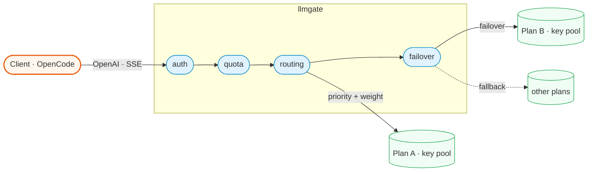

# llmgate

A single OpenAI-compatible gateway that aggregates API keys from multiple upstream model providers. Go + SQLite, single container, embedded admin UI.



## Features

- Channel key pools with priority / weight based routing; downstream switch on rate limit, quota exhaustion, or upstream error.
- Circuit breaker keyed to a consecutive-failure threshold (default 6 failures in 30s) with exponential backoff, cleared automatically after a successful probe.
- Per-user keys and quotas; API keys stored AES-256-GCM encrypted; disabling a channel deactivates all of its keys and routes.
- Per-user, per-model usage statistics and a dashboard; admin UI covering channels, routes, users, logs, and settings.

## Deploy

```bash
cp .env.example .env           # set LGM_ADMIN_TOKEN
docker compose up -d --build   # open http://localhost:3210
```

Setup: create a channel and add keys in **Channels**, run a connectivity test, sync models, then create a user and obtain a token in **Users**.

```bash
curl http://localhost:3210/v1/chat/completions \
  -H "Authorization: Bearer sk-your-token" -H "Content-Type: application/json" \
  -d '{"model":"deepseek/deepseek-v4-flash","messages":[{"role":"user","content":"hello"}]}'
```

## Configuration

Main environment variables are documented in [`.env.example`](.env.example) (`LGM_ADMIN_TOKEN`, `LGM_HTTP_ADDR`, `LGM_PROXY`, ...). Circuit-breaker parameters can be tuned in the admin Settings.

## Docs

- Deployment & operations: [deploy.md](docs/deploy.md)
- Design: [design.md](docs/design.md)

## License

[MIT](LICENSE) © 2026 Ma Tianyi